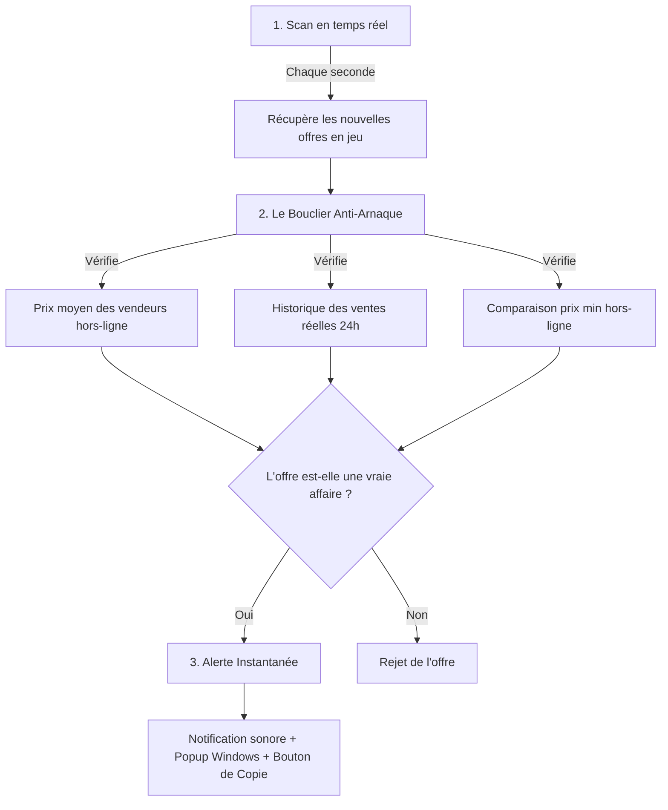

# 🎯 WARDEALS // Le Sniper Ultime de Deals Warframe.market

Bienvenue sur **WARDEALS**, ton compagnon de trading autonome et ultra-rapide pour **Warframe.market**. Conçu spécifiquement pour les marchands et les Tenno ambitieux, cet outil surveille le marché en temps réel et repère instantanément les erreurs de prix ou les ventes urgentes pour te permettre d'accumuler des milliers de Platines sans effort.

---

## 💡 Le Concept : Pourquoi cet outil existe-t-il ?

Dans Warframe, le **Platine** est le nerf de la guerre. Il permet d'acheter des emplacements d'inventaire, des réacteurs Orokin, des cosmétiques exclusifs, ou des mods légendaires.
Généralement, pour gagner du Platine, deux choix s'offrent à toi :
1. **Le "Grind" classique** (long et répétitif) : Ouvrir des reliques pendant des heures, lister ses pièces une par une sur le site et attendre qu'un acheteur te contacte.
2. **Le "Flipping" / Achat-Revente** (extrêmement lucratif) : Repérer les joueurs qui bradent leurs objets (par manque de patience ou par erreur de saisie), leur acheter sous le prix du marché, puis les revendre à leur vraie valeur.

**WARDEALS automatise entièrement la deuxième méthode.** Il agit comme un radar ultra-sensible posé sur ton PC :
* Il analyse chaque seconde les nouvelles annonces de vente.
* Dès qu'un joueur en jeu met en vente un objet à un prix anormalement bas (ex: une pièce Prime à 2 platines au lieu de 40), l'outil le détecte.
* Il t'alerte immédiatement par un signal sonore et une notification Windows, te donnant la commande de message prête à être collée dans le chat de Warframe.
* **Tu achètes en premier, tu revends plus tard, tu multiplies tes Platines.**

---

## 🛠️ Comment ça fonctionne (sans jargon technique) ?

Le fonctionnement de WARDEALS repose sur une logique humaine et sécurisée, découpée en 3 grandes étapes :

### 1. Le Scan Intelligent en temps réel
Chaque seconde, WARDEALS interroge Warframe.market pour récupérer les annonces de vente fraîches. Il filtre uniquement les vendeurs qui sont **actuellement connectés en jeu** (`In-Game`), car ce sont les seuls avec qui tu peux faire un échange immédiat.

### 2. Le Bouclier Anti-Arnaque (Évaluation Intelligente)
Pour éviter de te faire acheter un objet "faussement" bradé ou victime de manipulation de prix, le cerveau de WARDEALS applique trois filtres de sécurité uniques :
* **Le filtre hors-ligne** : Il compare l'offre avec les prix des vendeurs hors-ligne. Si l'offre en ligne est plus chère que ce que proposent les gens hors-ligne, elle est rejetée.
* **L'historique des ventes réelles** : Il analyse les vraies transactions effectuées par les joueurs sur les dernières 24 heures. Si les prix actuels du marché sont artificiellement gonflés par un groupe de joueurs, WARDEALS le détecte et bloque l'alerte.
* **Le filtre des rangs intermédiaires** : Pour les Mods ou Arcanes, certains joueurs listeront des rangs intermédiaires à des prix aberrants. WARDEALS vérifie et valide la valeur par rapport au rang exact (de 0 au max) pour bloquer 100% des fausses alertes.

### 3. L'Alerte et l'Achat en un Clic
Dès qu'une vraie opportunité est validée :
* Une carte dorée apparaît sur ton tableau de bord.
* Un son numérique retentit (sauf si coupé dans le menu).
* Une notification Windows surgit sur ton écran.
* Tu cliques sur le bouton **`📋 COPIER WHISPER`**, tu retournes sur ton jeu, tu fais `Ctrl+V` dans le chat, et tu effectues l'échange. Simple, net, ultra-rapide.

---

## 🌟 Les Fonctionnalités Majeures de ton Application

| Fonctionnalité | Description | Bénéfice pour toi |
| :--- | :--- | :--- |
| **⭐ Liste d'alertes (Watchlist)** | Définis précisément les objets que tu traques dans une liste. Si elle contient des items, seules les alertes pour ces objets retentiront ! | Tu cibles uniquement les objets les plus convoités du jeu sans nuisance sonore. |
| **☀️ Mode Clair Premium** | Change de thème visuel en un clic dans le pied de page pour un look blanc immaculé de haute volée. | Une lisibilité maximale et reposante en plein jour. |
| **💻 Mode Réduit Actif** | L'application est configurée pour empêcher la mise en veille Electron (`backgroundThrottling: false`). | Tu peux minimiser la fenêtre, le sniper continue de scanner en arrière-plan sans faiblir. |
| **📈 Statistiques en Direct** | Affiche les requêtes par minute, les deals trouvés, mais surtout le **Profit Moyen** et le **Gain Potentiel** cumulés sur ton écran ! | Tu mesures visuellement tes bénéfices potentiels instantanément. |
| **Auto-Copie Intelligent** | Cliquer n'importe où sur une carte pour ouvrir sa page WFM copie automatiquement le message de transaction (`whisper`) en arrière-plan. | Vitesse absolue : un seul clic pour ouvrir l'onglet de vente et copier le message de chat ! |
| **Filtres à double-synchro** | Tous les filtres (rarité par boutons circulaires, profit minimum, remise, masquage des vus) se synchronisent en temps réel. | Paramétrage simple, fluide et agréable sans rechargement. |

---

## 🚀 Guide d'Utilisation : Comment lancer l'app ?

WARDEALS est conçu pour s'exécuter sous forme d'une **application de bureau standalone native** ou dans ton navigateur internet :

* **Option A : Application Electron (Recommandé)** : Double-clique sur le fichier **`start_app.bat`** de ton dossier. Une fenêtre autonome au look gamer s'ouvre directement.
* **Option B : Version Navigateur** : Double-clique sur **`start_sniper.bat`** (ou lance la commande `npm start` dans le dossier), puis rends-toi sur **`http://localhost:3001`**.

---

## 🛡️ Sécurité : Est-ce risqué pour mon compte Warframe ?

**Absolument aucun risque !**
* **Aucune interaction avec les fichiers du jeu** : WARDEALS ne touche pas à ton jeu Warframe, ne modifie aucun fichier et n'injecte rien en mémoire. Il est 100% conforme à la charte de Digital Extremes.
* **Comportement humain sur le site** : L'outil fait des requêtes régulières et espacées sur Warframe.market, imitant le comportement d'un utilisateur normal qui rafraîchit sa page. Ta connexion et ton adresse IP sont totalement en sécurité.

---

*Que la fortune du Néant soit avec toi, Tenno. Bon trading !*
