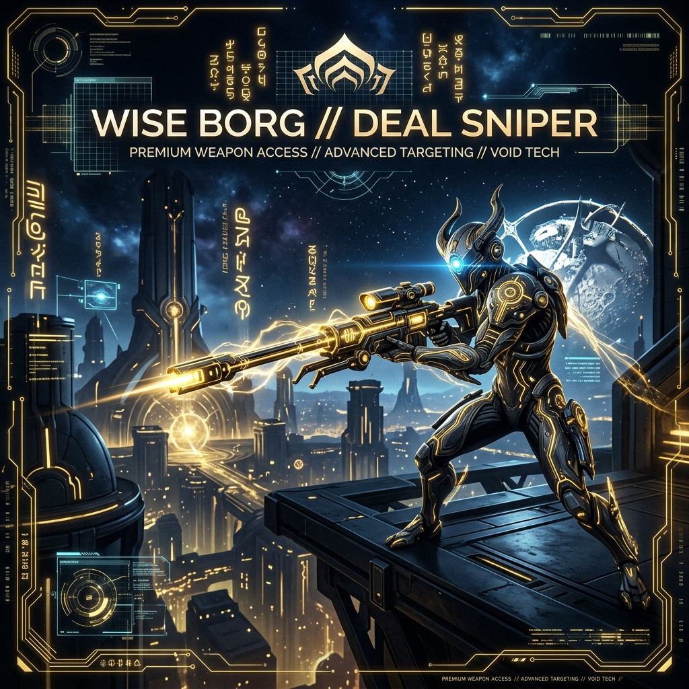

# 🎯 WISE BORG // Le Sniper Ultime de Deals Warframe.market

Bienvenue sur **Wise Borg**, ton compagnon de trading autonome et ultra-rapide pour **Warframe.market**. Conçu spécifiquement pour les marchands et les Tenno ambitieux, cet outil surveille le marché en temps réel et repère instantanément les erreurs de prix ou les ventes urgentes pour te permettre d'accumuler des milliers de Platines sans effort.

---

## 💡 Le Concept : Pourquoi cet outil existe-t-il ?

Dans Warframe, le **Platine** est le nerf de la guerre. Il permet d'acheter des emplacements d'inventaire, des réacteurs Orokin, des cosmétiques exclusifs, ou des mods légendaires.
Généralement, pour gagner du Platine, deux choix s'offrent à toi :
1. **Le "Grind" classique** (long et répétitif) : Ouvrir des reliques pendant des heures, lister ses pièces une par une sur le site et attendre qu'un acheteur te contacte.
2. **Le "Flipping" / Achat-Revente** (extrêmement lucratif) : Repérer les joueurs qui bradent leurs objets (par manque de patience ou par erreur de saisie), leur acheter sous le prix du marché, puis les revendre à leur vraie valeur.

**Wise Borgautomatise entièrement la deuxième méthode.** Il agit comme un radar ultra-sensible posé sur ton PC :
* Il analyse chaque seconde les nouvelles annonces de vente.
* Dès qu'un joueur en jeu met en vente un objet à un prix anormalement bas (ex: une pièce Prime à 2 platines au lieu de 40), l'outil le détecte.
* Il t'alerte immédiatement par un signal sonore et une notification Windows, te donnant la commande de message prête à être collée dans le chat de Warframe.
* **Tu achètes en premier, tu revends plus tard, tu multiplies tes Platines.**

---

## 🛠️ Comment ça fonctionne (sans jargon technique) ?

Le fonctionnement de Wise Borg repose sur une logique humaine et sécurisée, découpée en 3 grandes étapes :

### 1. Le Scan Intelligent en temps réel
Chaque minute, Wise Borg interroge Warframe.market pour récupérer les annonces de vente fraîches. Il filtre uniquement les vendeurs qui sont **actuellement connectés en jeu** (`In-Game`), car ce sont les seuls avec qui tu peux faire un échange immédiat.

### 2. Le Bouclier Anti-Arnaque (Évaluation Intelligente)
Pour éviter de te faire acheter un objet "faussement" bradé ou victime de manipulation de prix, le cerveau de Wise Borg applique trois filtres de sécurité uniques :
* **Le filtre hors-ligne** : Il compare l'offre avec les prix des vendeurs hors-ligne. Si l'offre en ligne est plus chère que ce que proposent les gens hors-ligne, elle est rejetée.
* **L'historique des ventes réelles** : Il analyse les vraies transactions effectuées par les joueurs sur les dernières 48 heures. Si les prix actuels du marché sont artificiellement gonflés par un groupe de joueurs, Wise Borg le détecte et bloque l'alerte.
* **Le filtre des rangs intermédiaires** : Pour les Mods ou Arcanes, certains joueurs listent des rangs intermédiaires (ex: Rang 3) à des prix aberrants. Wise Borg ramène automatiquement ces prix à la valeur du Rang 0 pour bloquer 100% des fausses alertes.

### 3. L'Alerte et l'Achat en un Clic
Dès qu'une vraie opportunité est validée :
* Une carte dorée apparaît sur ton tableau de bord.
* Un son numérique retentit.
* Une notification Windows surgit sur ton écran (même si tu joues à Warframe en plein écran).
* Tu cliques sur le bouton **`📋 COPIER WHISPER`**, tu retournes sur ton jeu, tu fais `Ctrl+V` dans le chat, et tu effectues l'échange. Simple, net, ultra-rapide.

---

## 🌟 Les Fonctionnalités Majeures de ton Application

| Fonctionnalité | Description | Bénéfice pour toi |
| :--- | :--- | :--- |
| **Interface Orokin Dorée** | Un tableau de bord sombre haut de gamme inspiré de l'esthétique du jeu. | Un confort visuel total, même pendant les longues sessions nocturnes. |
| **Notification de Bureau** | Des alertes Windows riches avec image de l'item, nom du vendeur, prix et profit estimé. | Tu peux regarder une vidéo ou jouer, tu ne rateras jamais un deal. |
| **Filtre de Rangs Avancé** | Choisis d'afficher uniquement les Mods/Arcanes Rang 0, Maxés, ou tous les rangs. | Tu cibles précisément ce que tu as les moyens d'acheter ou de revendre. |
| **Mémoire Ultra-Rapide** | Sauvegarde locale des prix moyens du marché sur ton PC. | L'application démarre et réagit en moins de 5 millisecondes au lancement. |
| **Whisper Anti-Propagation** | Copie le message de transaction en un clic sans ouvrir d'onglet parasite. | Vitesse d'exécution maximale pour contacter le vendeur avant les autres. |

---

## 🚀 Guide d'Utilisation : Comment lancer l'app ?

Wise Borg a été packagé sous forme d'une **application de bureau standalone native** pour ton PC.

1. Rends-toi sur ton **Bureau Windows**.
2. Repère le raccourci **Wise Borg Sniper** avec sa superbe icône de circuit dorée.
3. **Double-clique dessus** !
4. La fenêtre d'application s'ouvre directement. La console noire de commande s'exécute en tâche de fond de manière invisible et se ferme d'elle-même.
5. Ajuste tes filtres dans la barre latérale gauche (ex: *Bénéfice minimum = 15 platines, Pourcentage de réduction = 30%*).
6. Laisse tourner l'application et prépare-toi à copier les whispers !

---

## 🛡️ Sécurité : Est-ce risqué pour mon compte Warframe ?

**Absolument aucun risque !**
* **Aucune interaction avec les fichiers du jeu** : Wise Borg ne touche pas à ton jeu Warframe, ne modifie aucun fichier et n'injecte rien en mémoire. Il est 100% conforme à la charte de Digital Extremes.
* **Comportement humain sur le site** : L'outil fait des requêtes régulières et espacées sur Warframe.market (toutes les minutes), imitant le comportement d'un utilisateur normal qui rafraîchit sa page. Ta connexion et ton adresse IP sont totalement en sécurité.

---

*Que la fortune du Néant soit avec toi, Tenno. Bon trading !*
